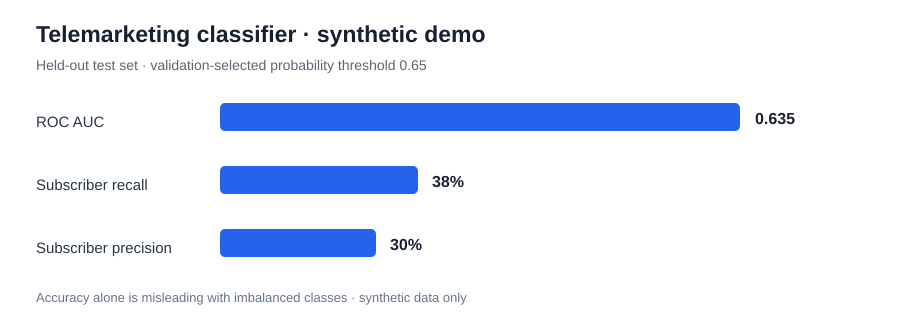

[](https://github.com/Mrroof/bank-telemarketing-analysis/actions)

# Bank Telemarketing Campaign Analysis

> **Portfolio case study · Python · pandas · scikit-learn · Matplotlib**

## Executive summary
This project explores patterns in a synthetic term-deposit campaign dataset and demonstrates how to evaluate a classifier when positive outcomes are relatively uncommon. It emphasizes recall, precision and average precision rather than relying on accuracy alone.

## Business questions
- How does the demo subscription rate vary by contact channel and job category?
- How does campaign contact frequency relate to subscription?
- How well can a pre-call model identify likely subscribers?

## Demonstration findings
- Overall synthetic subscription rate: **14.9%** (1,200 records).
- The original logistic-regression benchmark achieved **0.635 ROC AUC** and **0.316 average precision** on the held-out test sample.
- The original validation-selected threshold produced **38% subscriber recall** and **30% precision**.
- The updated workflow compares class-weighted logistic regression with a class-weighted random forest. Model selection uses validation average precision; the final test set is held back until evaluation.



The classifier is an exploratory ranking aid, not a high-performing or deployment-ready targeting model. Updated benchmark results are generated by GitHub Actions and saved as workflow artifacts.

## Method
1. Explore subscription rates by contact type and job category.
2. Split the records into training, validation and untouched test samples using stratification.
3. Compare logistic regression and random forest using validation average precision.
4. Select a probability threshold using validation F1.
5. Refit the selected model on all training data.
6. Evaluate ROC AUC, average precision, precision, recall, F1 and the confusion matrix on the held-out test set.

**Leakage control:** call duration is excluded because it is only known after a call and would leak post-call information into a pre-call targeting model.

## Run locally
```bash
pip install -r requirements.txt
python src/analyze_campaign.py
```

Outputs are written to `outputs/`, including the model comparison, classification report and precision-recall curve.

## Limitations and responsible use
The CSV is synthetic and does not represent a real bank campaign or real customers. The performance metrics are illustrative. A practical campaign model needs representative data, time-aware validation, calibration, a threshold based on campaign capacity and contact costs, and monitoring for drift and unfair impact.
